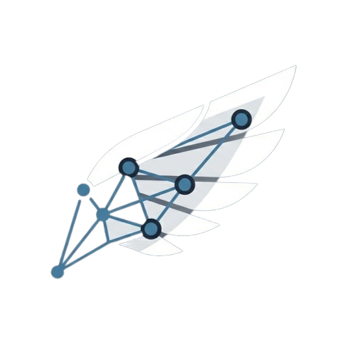

<div align="center">
  <a href="https://github.com/SGcpu/AeroGraph">
    
  </a>

  <h1 style="margin-top: 20px;">AeroGraph</h1>
  
  <p>
    <b>Cognitive observability and debugging layer for autonomous AI workflows.</b><br>
    <i>Local-first. Append-only. Replay-safe.</i>
  </p>

  <p>
    <a href="https://github.com/SGcpu/AeroGraph/stargazers">
      
    </a>
    <a href="https://github.com/SGcpu/AeroGraph/network/members">
      
    </a>
    <a href="https://github.com/SGcpu/AeroGraph/blob/main/LICENSE">
      
    </a>
  </p>

  <p>
    
    
    
  </p>

  <br>

  <p>
    <a href="#what-it-does"><b>What it does</b></a> &nbsp;&nbsp;✦&nbsp;&nbsp;
    <a href="docs/INTEGRATION_MANUAL.md"><b>Integration Manual</b></a> &nbsp;&nbsp;✦&nbsp;&nbsp;
    <a href="#cli-quickstart-aerorepl"><b>Quick Start</b></a> &nbsp;&nbsp;✦&nbsp;&nbsp;
    <a href="#architecture"><b>Architecture</b></a> &nbsp;&nbsp;✦&nbsp;&nbsp;
    <a href="#contributing"><b>Contributing</b></a>
  </p>
</div>

---

## Table of Contents

- [What it does](#what-it-does)
- [Developer Integration Manual (Complete Guide)](docs/INTEGRATION_MANUAL.md)
- [Terminology & Concepts](#terminology--concepts)
  - [Fork-and-Resume ("Fork from here")](#fork-and-resume-fork-from-here)
  - [Lineage & Navigation](#lineage--navigation)
  - [Identifiers in Error Messages](#identifiers-in-error-messages)
- [Repository structure](#repository-structure)
- [Deterministic Replay & `aerorepl`](#deterministic-replay--aerorepl)
  - [How it works](#how-it-works)
  - [Scenario-Aware Analytics & Dual Token Accounting](#scenario-aware-analytics--dual-token-accounting)
  - [Tool Safety Policy](#tool-safety-policy)
  - [Writing Replay-Ready Agent Scripts](#writing-replay-ready-agent-scripts)
  - [CLI Quickstart (`aerorepl`)](#cli-quickstart-aerorepl)
- [Development & Running Components](#development--running-components)
  - [Prerequisites](#prerequisites)
  - [1. Building Replay Core](#1-building-replay-core-go-mitm-proxy)
  - [2. Starting Collector & Orchestrator](#2-starting-collector--orchestrator)
  - [3. Starting the Web UI](#3-starting-the-web-ui)
  - [4. Running the CLI (`aerorepl`)](#4-running-the-cli-aerorepl)
  - [5. Running Demos](#5-running-demos)
  - [6. Project Configuration](#6-project-configuration)
  - [7. Updating Cross-Language Artifacts](#7-updating-cross-language-artifacts)
- [API Endpoints](#api-endpoints)
- [OpenTelemetry Interoperability](#opentelemetry-interoperability)
- [Architecture](#architecture)
- [TypeScript / Node.js Packages](#typescript--nodejs-packages)
- [Go Core Proxy](#go-core-proxy)
- [Applications](#applications)
- [Contributing](#contributing)
  - [The contract-first architecture](#the-contract-first-architecture)
  - [Do I need to write code in both TypeScript and Python?](#do-i-need-to-write-code-in-both-typescript-and-python)
  - [Workflow A - Adding or changing an event field](#workflow-a)
  - [Workflow B - Adding a new adapter (new framework)](#workflow-b)
  - [Workflow C - Fixing a bug or adding a feature in the collector or web UI](#workflow-c)
  - [Workflow D - Python-only changes (recorder logic, helpers)](#workflow-d)
  - [CI gates and what breaks them](#ci-gates-and-what-breaks-them)
  - [Pre-Push & Release Hygiene Checklist](#pre-push--release-hygiene-checklist)
  - [Commit and PR conventions](#commit-and-pr-conventions)
  - [Running everything locally](#running-everything-locally)

---

## What it does

### Core Capabilities

- **Normalized Agent Tracing**: Captures **prompts**, **responses**, **tool calls**, **tool results**, **retrievers**, **handoffs**, **checkpoints**, and **errors** as 10 canonical event types across a replay-safe, append-only SQLite store.
- **Interactive Trace Graph & Playback**: Visualizes execution flow as a dynamic ReactFlow graph with dual-edge layout (dashed hierarchy tree vs solid state machine transitions), step-by-step playback, payload inspection, and failure highlighting.
- **Trace Branching & Lineage Navigation**: "Fork" alternate timelines from any span (`derivedFrom`), navigate full lineage breadcrumbs, and perform Myers diff comparisons with instant delta metric cards for tokens, latency, and loop resolution.
- **Deterministic Zero-Cost Replay & Fork-and-Resume**: Intercepts model and tool network traffic into deterministic, content-addressed cassettes (`.aerograph/cassettes/`). Replay past agent executions with zero token cost (<5ms per step), or one-click "Fork and Resume" directly from any span in the Web UI or via the interactive `aerorepl` CLI.
- **Dual-Accounting Token Analytics**: Distinguishes **Live Billed Tokens** ($ spend) from **Cached / Replayed Tokens** ($0.00 saved). Tracks scenario savings percentages across Record, Strict Replay, and Fork & Resume runs with per-model source attribution (`🟢 Cached`, `⚡ Live`, `Mixed`) and wire-level proxy routing summaries.
- **LangGraph & Cyclic State Observability**: Automatic LangGraph node boundary detection, state loop tripwires with purple halo highlights, side-by-side Input/Output (`state_before` vs `state_update`) state views, human-in-the-loop interrupt handling, and deterministic state hashing (`stateHash`).
- **Streaming Telemetry & RAG Inspection**: Live Time-to-First-Token (TTFT), tokens/sec metrics, and first-class retrieval query & document inspection.
- **Multi-Language Support (TypeScript & Python)**: Native SDKs (`@aerograph/sdk` and `aerograph-sdk`) and LangChain adapters (`@aerograph/adapter-langchain` and `aerograph-langchain`) with zero contract drift and verified cross-language parity.
- **Ephemeral Security & Credential Hygiene (Principle VI)**: Zero private key persistence for MITM proxy CAs, strict redaction of authentication headers (`Authorization`, `X-Api-Key`, `Cookie`) and secret query parameters in cassettes, and automated pre-push security scanning.
- **OpenTelemetry (OTel) Bridge**: Bidirectional export & import between AeroGraph events and standard OTLP JSON spans via `@aerograph/otel` and `aerograph-otel`, plus native `/v1/otlp/traces` ingestion.
- **Contract-Driven Guarantee**: All backend, UI, adapter, and bridge payloads are validated strictly through shared `@aerograph/contracts` schemas.


## Terminology & Concepts

To help you navigate and understand the trace graph and AeroGraph's capabilities, here are key concepts explained:

### Fork-and-Resume ("Fork from here")
- **What it is**: Imagine reading a "Choose Your Own Adventure" book. You read up to page 50, and you want to see what would happen if the agent made a different decision, received an alternative prompt, or called a different tool. Fork-and-Resume creates a new derived trace starting from that exact step (a span) in an existing trace.
- **How it works with Deterministic Replay**:
  AeroGraph connects trace observability directly to execution via the local Orchestrator and `aerograph-replay-core`:
  1. **One-Click in Web UI**: Click on any node in the trace graph and select **⑂ Fork and Resume**.
  2. **Prompt & Input Modification**: A modal appears displaying the step details. You can optionally edit the prompt or input text right inside the UI to explore an alternate execution path.
  3. **Zero-Cost Pre-Fork Execution**: The Orchestrator automatically slices the recorded cassette (`.aerograph/cassettes/<runId>.json`) up to the fork span. All steps prior to the fork point are served instantly from the local cassette cache with **zero token cost and <5ms latency**.
  4. **Live Post-Fork Execution**: Post-fork steps execute live with the new prompt or modified agent code. Tool calls follow your safety policy (`aerograph.replay.yaml`).
  5. **Instant Divergence Diff**: As soon as execution completes, AeroGraph automatically performs a Myers diff between the parent and child traces, highlighting where and how the alternate timeline diverged.
  6. **Terminal Alternative (`aerorepl`)**: The same fork-and-resume workflow is available in terminal environments via `aerorepl session <runId>` with the `/fork <spanId>` command.
  7. *(Offline / Manual Fallback)*: When the Orchestrator service is offline, the modal offers a "Generate Fork ID Only" toggle to generate a fork ID for manual script execution.

### Lineage & Navigation
Because you can fork traces multiple times, AeroGraph tracks how traces relate to each other (their lineage):
- **Derived from**: Think of this as the "parent" timeline. If you forked Trace B from Trace A, then Trace B is *derived from* Trace A. It tells you the origin story of the current trace.
- **Siblings**: If you return to the same bookmark in the story and make three different choices, you get three new timelines. These three traces are *siblings* because they were all forked from the exact same point in the same parent trace.
- **Breadcrumb**: This is your trail back home. When navigating a complex set of forks (e.g., Trace A → Trace B → Trace C), the breadcrumb trail shows you exactly how you got to the current trace, allowing you to easily jump back up the family tree.

### Identifiers in Error Messages
- **Random strings (e.g., `s_AZ70SfRdcNGomaW3-cNdFA_error`)**: These are unique IDs (Span IDs or Trace IDs) generated by the system to precisely pinpoint where an event happened. Think of it like a tracking number for a package. If a package (event) gets lost or damaged (error), the tracking number tells you exactly which step failed. You can search for this ID in the system to go directly to the exact point of failure in the trace graph.

### Workflow Topology vs. Trace Graph
- **Trace Graph**: The raw, chronological tree of all low-level spans (model calls, internal state transitions, tool invocations, and retrievals). Ideal for inspecting step-by-step latency, raw payloads, and parent-child execution hierarchies.
- **Workflow Topology (State Graph)**: An aggregated, framework-agnostic architectural diagram inspired by Arize Phoenix. It collapses repetitive loops (e.g. `supervisor ↔ researcher ↔ fact_checker`) into single logical state machine nodes with cycle multipliers (`cycle ×4`) and iteration history drawers.
- **Trajectory Path (Storyboard Grid)**: A 4-column wrapping storyboard view laying out steps chronologically (`Step 1 → Step 2 → ...`). It keeps multi-turn executions 100% legible at full scale without shrinking cards into unreadable dots.

### Agentic Loop & Failure Detection Concepts
When autonomous agents run in production or complex evaluations, they fail in ways traditional software does not. AeroGraph provides an intelligent analysis engine (`GET /v1/traces/:id/analysis`) that detects these patterns automatically:

- **What is an Agent Handoff?**
  In multi-agent architectures (LangGraph multi-agent, CrewAI, AutoGen, OpenAI Swarm), an agent rarely solves a complex task alone. Instead, a supervisor agent delegates subtasks to specialized worker agents (e.g., `lead_researcher` hands off to `fact_checker`). A handoff represents this transfer of execution authority and state between agents.
- **Multi-Agent Ping-Pong (Handoff Cycles)**:
  A failure mode where two or more agents endlessly pass the task back and forth without resolving it (e.g. Agent A asks Agent B for data, Agent B says data is missing and passes it back to Agent A, repeating indefinitely). AeroGraph identifies direct ping-pong ($A \leftrightarrow B$) and transitive cycles ($A \rightarrow B \rightarrow C \rightarrow A$) across both explicit handoff events and framework-agnostic actor transitions.
- **Repeated Sequence & Oscillatory Motifs**:
  Occurs when an agent enters a cyclic feedback loop across multiple tools or state nodes (e.g. `LLM → search → scrape → LLM → search → scrape`). AeroGraph uses dynamic n-gram motif discovery to detect these oscillations even when passive telemetry notes or checkpoints are interleaved between steps.
- **Recursive Tool Calls Without Progress**:
  An agent calling a tool multiple times is not always a bug (e.g., paginating search results is legitimate). It becomes a failure mode when the agent calls the tool repeatedly **without making progress**—either because:
  1. The agent slightly rephrases queries (e.g., `"weather in NYC today"` vs `"current weather NYC"`) that all return empty result sets (`[]`, `null`, or `"no results found"`).
  2. The tool returns identical stagnant responses across multiple turns.
  3. The tool fails with repeated errors without the agent modifying its approach.
- **Classified Failure Cascades & Root Cause Attribution**:
  In multi-step workflows, an initial failure (e.g., an HTTP 429 rate limit or schema validation error) often triggers a cascade of secondary failures (supervisor panics, timeout aborts). AeroGraph classifies errors into standard taxonomies (`[RATE_LIMIT_OR_TIMEOUT]`, `[SCHEMA_VALIDATION]`, `[HALLUCINATED_TOOL]`, `[AUTH_FAILURE]`, `[RECURSION_OR_CONTEXT_LIMIT]`, `[RUNTIME_ERROR]`) and explicitly tags the primary initiating error as `[Root Cause]` versus downstream `[Cascaded]` secondary errors.

### Modern Agent Debugging Detectors: Current & Roadmap
Beyond cyclic loops and basic exceptions, modern agent debugging platforms (such as Arize Phoenix, Langfuse, Openlayer, and Latitude.so) identify several specialized agent failure modes:

| Failure Mode / Detector | What it Detects | Status in AeroGraph |
| :--- | :--- | :--- |
| **Repeated Sequence / Oscillatory Loops** | Repeating multi-step tool/state motifs (`LLM → tool_A → tool_B` $\times N$) | ✅ **Active** (`repeatedSequence.ts`) |
| **Recursive Tool Without Progress** | Fuzzy input similarity ($\ge 0.70$) with empty, stagnant, or error outputs | ✅ **Active** (`recursiveTool.ts`) |
| **Multi-Agent Handoff Ping-Pong** | Directed delegation cycles and ping-pong deadlocks ($A \leftrightarrow B$) | ✅ **Active** (`handoffCycle.ts`) |
| **Root-Cause Failure Cascades** | Distinguishing primary failure (e.g. 429 / schema) from secondary aborts | ✅ **Active** (`analysis/index.ts`) |
| **Context Window Creep / Token Bloat** | Unbounded token growth across multi-turn sessions without summarization | 🔮 *Roadmap* (tracked via Dual Token Accounting) |
| **Critical Path Latency Bottleneck** | Pinpointing whether delay originated from model TTFT or stalling third-party API | 🔮 *Roadmap* (observable via Duration Delta) |
| **Ignored Tool Context / Hallucination** | Agent retrieves valid tool context but hallucinates answers contradicting it | 🔮 *Roadmap* (planned evaluation bridge) |
| **Goal Drift / Task Stagnation** | Agent diverges from the original user prompt into unrelated sub-tasks | 🔮 *Roadmap* |

## Repository structure

- `packages/contracts`: event schema + shared contracts (source of truth)
- `packages/sdk`: reference SDK for emitting normalized trace events (Node.js)
- `packages/adapter-langchain`: MVP adapter for LangChain workflows (Node.js)
- `packages/otel`: OpenTelemetry export/import bridge (Node.js)
- `packages/aerorepl`: interactive CLI for recording, replaying, and step-inspecting agent runs
- `packages/replay-core`: local Go-based MITM proxy for deterministic caching and replaying
- `python/aerograph-sdk`: reference SDK for emitting normalized trace events (Python)
- `python/aerograph-langchain`: MVP adapter for LangChain workflows (Python)
- `python/aerograph-otel`: OpenTelemetry export/import bridge (Python)
- `apps/collector`: trace ingest + SQLite storage + Orchestrator (port 4318) + lineage/diff/analysis endpoints
- `apps/web`: interactive trace graph UI with replay badges, fork-and-resume modal, and diff divergence views
- `apps/demo`: demo emitter + Phase 2 smoke demo

## Deterministic Replay & `aerorepl`

AeroGraph includes a local-first **Deterministic Replay** engine backed by `aerograph-replay-core`.

### How it works
1. **Record**: Intercepts outgoing HTTP/HTTPS calls made by your agent and saves responses into a content-addressed cassette (`.aerograph/cassettes/<runId>.json`).
2. **Replay**: Re-runs the agent with network calls fulfilled directly from the cassette cache with **<5ms latency and zero token cost**.
3. **Fork and Resume**: Diverge from any point in the execution trace. Pre-fork steps are served from cache; post-fork steps run live.
4. **Tool Safety Policy**: `aerograph.replay.yaml` configures which URLs are `replay_safe` (cache) versus `must_execute` (live side effects like payments).

### Scenario-Aware Analytics & Dual Token Accounting

AeroGraph's analytics engine provides transparent financial and performance accounting across different execution topologies:

| Execution Mode | Behavior | Token Cost ($) | Wall-Clock Latency |
| :--- | :--- | :--- | :--- |
| **`⏺ RECORD RUN`** | Live execution against LLM and tool providers | 100% Live Billed | Provider latency (~10–35s) |
| **`▶ STRICT REPLAY`** | Replays 100% deterministically from local cassette | **$0.00 (0 live tokens)** | Local cache (~300ms, 80–100x speedup) |
| **`🌿 FORK & RESUME`** | Pre-fork steps replayed from cassette; post-fork runs live | Only post-fork billed | Hybrid savings proportional to fork depth |

- **Dual Token Grid**: The analytics panel segregates **Live Billed Tokens** ($ spend) from **Cached / Saved Tokens** ($0.00) and displays the calculated savings percentage (e.g. `100% saved` on strict replay, `26% saved` on partial fork).
- **Per-Model Source Attribution**: The model breakdown table categorizes every model row with visual status pills: `🟢 Cached`, `⚡ Live`, or `Mixed`.
- **Wire-Level Routing Summary**: Displays proxy intercept decisions directly in the telemetry header (`✓ X Cache Hits`, `⚡ Y Live Calls`, `⚠ Z Unclassified`).
- **1-Click Base Comparison**: Any derived trace displays a `[ ⚖ Compare with Base ]` button that immediately opens the Myers diff comparison against its parent run.
- **Diff Metric Cards**: The visual diff panel highlights **Tokens Delta**, **Duration Delta**, and flags whether an execution resolved a previous infinite loop (`✓ Loop resolved!`).

### Writing Replay-Ready Agent Scripts

AeroGraph executes agent workflows in an **automated, headless environment** when recording, replaying, or forking. To ensure smooth, crash-free execution, follow two simple practices:

#### 1. Pass Inputs via Arguments or Environment Variables (Avoid bare `input()`)
In background, UI-driven, or CI runs, no interactive keyboard terminal is attached. If a script calls bare `input()`, Python will encounter an `EOFError`.

Instead, structure your script to accept inputs from CLI arguments or environment variables, with a safe fallback:

```python
import sys
import os

# ✅ Best Practice: Non-blocking, automated input
if len(sys.argv) > 1:
    user_query = " ".join(sys.argv[1:])
elif os.getenv("AGENT_QUERY"):
    user_query = os.getenv("AGENT_QUERY")
elif sys.stdin.isatty():
    user_query = input("Enter prompt: ")  # Only prompts if run directly in an interactive terminal
else:
    user_query = "Plan a 3-day trip to Kashmir from Mumbai"  # Automated fallback

print(f"Running agent with query: {user_query}")
```

#### 2. Preserve AeroGraph's TLS Proxy Certificates
When AeroGraph records or replays HTTPS traffic, it automatically manages `REQUESTS_CA_BUNDLE` and `SSL_CERT_FILE` with a local ephemeral certificate so it can inspect model and tool calls.

Avoid hardcoding `certifi.where()` unconditionally over these variables in your code:

```python
import os
import certifi

# ❌ Avoid: Overwriting AeroGraph's injected CA bundle triggers SSL verification failures
# os.environ["REQUESTS_CA_BUNDLE"] = certifi.where()

# ✅ Recommended: Only set default CA if not already provided by AeroGraph
if "REQUESTS_CA_BUNDLE" not in os.environ:
    os.environ["REQUESTS_CA_BUNDLE"] = certifi.where()
if "SSL_CERT_FILE" not in os.environ:
    os.environ["SSL_CERT_FILE"] = certifi.where()
```

### CLI Quickstart (`aerorepl`)
```bash
# View active configuration and safety rules:
npx aerorepl config get

# Set and store your agent command (.aerograph/aerograph.project.yaml):
npx aerorepl config set python agent.py

# Paste or import configuration (auto-detects project command vs tool policy):
npx aerorepl config paste aerograph.replay.yaml
# Or interactively paste and finish with 'END':
npx aerorepl config paste

# Record an agent run into a deterministic cassette:
npx aerorepl record python agent.py

# Replay an existing run from cassette cache (zero token cost):
npx aerorepl replay <runId>

# Interactive step inspection and live prompt override:
npx aerorepl session <runId>
# Inside the session:
# /step                       Advance one step
# /inspect <spanId>           Inspect full payload of a span (reflects active overrides)
# /override <spanId> <input>  Override prompt (accepts multi-line JSON, @file.json, or raw text)
# /rewind 1                   Rewind to previous step
# /fork <spanId>              Fork alternate execution from span
# /quit                       Exit session
```

See [Deterministic Replay Quickstart](specs/006-deterministic-replay/quickstart.md) and [Replay Getting Started](docs/replay/getting-started.md) for full documentation.

## Development & Running Components

### Prerequisites
- **Node.js**: ≥ 18.18.0 (LTS recommended)
- **Go**: ≥ 1.21 (required for building `aerograph-replay-core`)
- **Python**: ≥ 3.10 with [`uv`](https://github.com/astral-sh/uv) (for Python SDK/adapter workflows)

Install Node dependencies across all workspaces and compile packages:
```sh
# 1. Install dependencies
npm install

# 2. Build contracts and workspace packages (generates dist/ outputs)
npm run build
```

### 1. Building Replay Core (Go MITM Proxy)
Before running deterministic replay or recording sessions, compile the `aerograph-replay-core` binary:

```sh
# On Windows:
cd packages/replay-core
go build -o bin/aerograph-replay-core.exe main.go
cd ../..

# On Linux/macOS:
cd packages/replay-core
go build -o bin/aerograph-replay-core main.go
cd ../..
# Alternatively: make -C packages/replay-core build
```
Verify the build:
```sh
./packages/replay-core/bin/aerograph-replay-core --version
```
*See [packages/replay-core/README.md](packages/replay-core/README.md) and [Windows Setup Guide](docs/replay/windows-setup.md) for detailed platform notes.*

### 2. Starting Collector & Orchestrator
Running the collector starts both the **Collector Service** (port 4317) and the **Orchestrator Engine** (port 4318) concurrently:

```sh
npm run dev -w apps/collector
```
- **Collector (`http://localhost:4317`)**: Ingests trace events (`POST /v1/events`), serves trace queries, lineage graphs, analytics, and diffs.
- **Orchestrator (`http://localhost:4318`)**: Coordinates deterministic replay runs, manages interactive REPL sessions, slices cassettes, and executes live fork-and-resume workflows.

### 3. Starting the Web UI
In a separate terminal, launch the React/Vite flight recorder interface:

```sh
npm run dev -w apps/web
```
Open **`http://localhost:5173`** in your browser to inspect traces, visualize execution flow, execute 1-click **⑂ Fork and Resume**, view divergence diffs, and inspect token usage.

### 4. Running the CLI (`aerorepl`)
You can use `aerorepl` locally via `npx` or by linking it:

```sh
# Build aerorepl:
npm run build -w packages/aerorepl

# Record an agent execution:
npx aerorepl record python agent.py

# Replay an execution deterministically (zero token cost):
npx aerorepl replay <runId>

# Launch an interactive stepping session:
npx aerorepl session <runId>

# List all recorded runs:
npx aerorepl list
```
*See [packages/aerorepl/README.md](packages/aerorepl/README.md) for complete CLI syntax and interactive session commands.*

### 5. Running Demos
Test the full pipeline end-to-end:

```sh
# 1. Start collector & orchestrator (terminal 1):
npm run dev -w apps/collector

# 2. Emit a sample multi-agent trace (terminal 2):
npx tsx apps/demo/src/demo.ts

# 3. Run the complete fork → diff → analysis smoke test:
npx tsx apps/demo/src/phase2-demo.ts
```

### 6. Project Configuration & Zero-Manual-File Setup
AeroGraph is designed so that you **never have to manually drop configuration files into your repository root**. You can configure and bind your project directly from the **Web UI** or the **Terminal**:

#### Option A: In the Web UI (Zero-File)
- **Header Config Modal (`⚙️ Config`)**: Click the `⚙️ Config` button in the top navigation bar to view your active command, pick presets (`uv run agent.py`, `npm run start`, `npx tsx agent.ts`), or paste raw YAML.
- **Directly Inside Fork & Resume**: When clicking **"⑂ Fork and Resume"** from any span in the trace graph, you can paste or edit your command/YAML right inside the modal. It will bind automatically to the project and run immediately without errors.
- The configuration automatically saves to `.aerograph/aerograph.project.yaml`, keeping your workspace root completely clean.

#### Option B: In the Terminal (`npx aerorepl config`)
- **View active configuration and safety rules**:
  ```sh
  npx aerorepl config get
  ```
- **Set/bind agent command**:
  ```sh
  npx aerorepl config set uv run examples/openrouter-langgraph-py/agent.py
  ```
- **Paste configuration interactively (type 'END' on a new line when done)**:
  ```sh
  npx aerorepl config paste
  ```
- **Import an existing configuration or tool policy directly**:
  ```sh
  npx aerorepl config paste aerograph.replay.yaml
  # Or via import:
  npx aerorepl config import aerograph.replay.yaml
  ```
- **Auto-Bind on Record**: When executing `npx aerorepl record -- <command...>`, `aerorepl` automatically stores the command in `.aerograph/aerograph.project.yaml` so all future replays and Web UI forks reuse it seamlessly.

> **Smart Auto-Detection**: `aerorepl config paste` and `import` automatically detect whether your YAML defines a **Tool Safety Policy** (`tools: [...]` → saved to `aerograph.replay.yaml`), an **Agent Project Command** (`command: [...]` → saved to `.aerograph/aerograph.project.yaml`), or both!

#### Configuration Reference
- **`.aerograph/aerograph.project.yaml`** (or root `aerograph.project.yaml`): Specifies the execution command, project identity, and service URLs.
- **`aerograph.replay.yaml`**: Defines your [Safety Policy](docs/replay/safety-policy.md), specifying which hosts/tools are `replay_safe` (cached) vs `must_execute` (live), command blacklists, and loop tripwire thresholds.

### 7. Span Correlation & Adapter Development Guide
For developers contributing or building framework adapters (e.g. LangChain, LlamaIndex, AutoGen, CrewAI):

#### The Correlation Challenge with Standard HTTP Clients
When an agent framework makes external calls (such as completions to OpenAI/Anthropic/OpenRouter, or web requests via tool libraries):
- Telemetry events emitted by the adapter (e.g. LangChain callback handler or OTel exporter) produce `prompt`, `response`, `tool_call`, and `tool_result` spans with unique `spanId`s.
- Network calls intercepted by the Go MITM proxy (`aerograph-replay-core`) capture HTTP request/response steps into a cassette and emit an annotation log (`afr_ann_<runId>.json`).
- Standard HTTP clients (such as Python `langchain-openai`, `requests`, `httpx`, `urllib3`, or standard `fetch`) **do not send custom telemetry headers** like `X-AeroGraph-Span-Id`. In raw proxy captures, `correlatedSpanId` is therefore empty.

#### AeroGraph's Dual-Correlation Solution
1. **Explicit Header Injection (Recommended when custom clients are available)**:
   If your adapter controls the HTTP client or custom fetch/session wrapper, injecting `X-AeroGraph-Span-Id: <spanId>` on outbound HTTP calls allows the Go proxy to achieve exact $O(1)$ correlation.
2. **Sequential Fallback Correlation (Built-in)**:
   When `X-AeroGraph-Span-Id` is absent, the AeroGraph Runner sequentially matches HTTP annotation entries with application `prompt` and `response` spans in chronological order, attaching `replaySource` (`⚡ CACHE` vs `🌐 LIVE`), `decision`, `replayLatencyMs`, and `requestKey`.
3. **Safety Policy Stamping on Tool Spans**:
   All `tool_call` and `tool_result` spans are matched against `aerograph.replay.yaml` rules. Spans receive `effectiveClass: "replay_safe"` (`🟢 REPLAY SAFE`) or `effectiveClass: "must_execute"` (`🔴 MUST EXECUTE`).

See the [Adapter Authoring Guide](docs/adapters/authoring-guide.md) for full developer guidelines.

### 7. Updating Cross-Language Artifacts
AeroGraph is contract-first. If you modify contracts in `packages/contracts`, update the derived JSON schemas and Python models:

```sh
# 1. Export JSON Schemas
npm run schema:export -w packages/schema-exporter

# 2. Regenerate Python models
uv run python/aerograph-sdk/tools/generate_contracts.py

# 3. Check for contract drift in CI
npm run drift:check
```

---

## API Endpoints

AeroGraph exposes clean REST APIs on the Collector (port 4317) and Orchestrator (port 4318):

### Trace Ingestion & Retrieval (Collector `:4317`)
| Endpoint | Method | Description |
|---|---|---|
| `/v1/events` | `POST` | Ingest trace events (supports single event or batch) |
| `/v1/traces` | `GET` | List traces (supports `?projectId=` and `?environment=` filtering) |
| `/v1/traces/:id` | `GET` | Get trace details, spans, and metadata |
| `/v1/traces/:id/lineage` | `GET` | Retrieve complete ancestor and descendant lineage graph |
| `/v1/traces/:aId/diff/:bId` | `GET` | Compute lineage-aware deterministic Myers diff between two traces |
| `/v1/traces/:id/analysis` | `GET` | Detect loop warnings and failure patterns |
| `/v1/traces/:id/stats` | `GET` | Trace analytics (duration, token usage, model breakdown) |
| `/v1/otlp/traces` | `POST` | Ingest OpenTelemetry OTLP JSON trace spans |
| `/health` | `GET` | Collector health and database status |

### Deterministic Replay & Fork-and-Resume (Orchestrator `:4318`)
| Endpoint | Method | Description |
|---|---|---|
| `/v1/traces/:id/fork-and-resume` | `POST` | **1-Click Fork & Resume**: slices cassette, spawns replay run, executes post-fork live, computes divergence diff |
| `/v1/traces/:id/fork` | `POST` | Classic metadata fork (creates child trace ID linked to span) |
| `/v1/traces/:id/replay` | `POST` | Replay an existing trace using its recorded network cassette |
| `/v1/runs` | `POST` | Start a background agent run (record or replay mode) |
| `/v1/runs/:id` | `GET` | Query run status, exit code, and trace reference |
| `/v1/sessions` | `POST` | Create an interactive step-by-step replay session |
| `/v1/sessions/:id` | `GET` | Get interactive replay session state |
| `/v1/sessions/:id/action` | `POST` | Execute session action: `step`, `inspect`, `override`, `rewind`, `fork` |
| `/v1/sessions/:id` | `DELETE` | Terminate active replay session |
| `/v1/cassettes/:id` | `GET` | Retrieve raw recorded network cassette |

## OpenTelemetry Interoperability

AeroGraph provides a bidirectional OpenTelemetry (OTLP) bridge via `@aerograph/otel` (TypeScript) and `aerograph-otel` (Python).
- **Export**: Send AeroGraph traces to Jaeger, Datadog, or any OTLP-compatible backend.
- **Import**: Ingest external OTLP spans into the AeroGraph collector via the `POST /v1/otlp/traces` endpoint.


## Architecture

- **No distributed infrastructure**: no queues, no collectors, no Kubernetes - all local SQLite
- **Contract-first**: all API shapes defined in `@aerograph/contracts` (Zod); validated on every ingress/egress
- **Append-only**: events and lineage edges are never mutated; forking copies prefix events
- **Deterministic**: ordering, diff, and loop analysis produce the same result for the same input

## How Aerograph compares

Aerograph is a cognitive observability and debugging layer for autonomous AI workflows, not an execution or orchestration engine.

### The core difference

| Tool | The core question it answers | The developer's UX |
|---|---|---|
| `trigger.dev` / `inngest.com` | How do we reliably execute and orchestrate this workflow at scale? | Infrastructure logs, queue states, retry schedules, and execution backbones. |
| `LangSmith` / `LangChain` | How is my LLM app performing, and what did this specific prompt cost/trace to? | Structured telemetry, prompt logs, token counts, and LLM evaluation datasets. |
| `Aerograph` | Why did my autonomous agents just make that decision? | A visual, replayable graph of reasoning paths, context drift, and emergent agent behavior. |

### Detailed breakdown

| Tool | Primary focus | Where Aerograph differs |
|---|---|---|
| `trigger.dev` | Reliable background job execution, durable task infrastructure, and operational recovery. | Aerograph does zero execution. While Trigger ensures the system runs, Aerograph traces why it ran that way - detecting loops and hallucinated agent handoffs. |
| `inngest.com` | Event-driven workflow engines, long-running functions, and event coordination. | Aerograph is a flight recorder, not an engine. Inngest acts as the execution backbone; Aerograph acts as the DevTools layer to inspect internal behavioral failure points. |
| `LangSmith` | LLM app tracing, prompt evaluation datasets, and production telemetry. | Aerograph is framework-agnostic cognitive debugging. Instead of linear log traces, Aerograph reconstructs multi-agent reasoning graphs, memory interactions, and decision paths in a replayable UI. |

## How This Project Is Split

This repository serves two different audiences:

- Contributors work in the monorepo and run the collector, web UI, demos, and tests locally.
- End users consume the reusable packages, usually `@aerograph/sdk`, `@aerograph/adapter-langchain`, `aerograph-sdk`, and `aerograph-langchain`, from their own application.

That split is intentional. The repo contains the product, but the public integration surface is the SDK and adapters. The collector and web UI are the viewing and storage layer that can be run locally or hosted separately.

## Deployment Model

There are two supported ways to ship AFR:

- **Self-hosted**: users run the collector and web UI themselves, then point their app at the collector endpoint.
- **Hosted**: you run the collector and web UI as a service, and users only install the SDK or adapter in their own project.

---

## TypeScript / Node.js Packages

AeroGraph provides native TypeScript libraries for capturing and validating traces.

### `@aerograph/contracts`
The single source of truth for all AeroGraph Event schemas using Zod. Use this package if you are building custom ingestion tools or new language SDKs that need schema validation in TypeScript.
```bash
npm install @aerograph/contracts
```

### `@aerograph/sdk`
The core Node.js Flight Recorder for emitting normalized trace events from any JavaScript/TypeScript codebase.
```bash
npm install @aerograph/sdk
```
```typescript
import { FlightRecorder } from "@aerograph/sdk";

const recorder = new FlightRecorder({ endpoint: "http://localhost:4317", actor: { id: "agent-1" } });
await recorder.prompt({ text: "Hello!" });
```

### `@aerograph/adapter-langchain`
An automatic callback adapter for LangChain.js. Records prompts, tools, RAG queries, and multi-agent handoffs with zero boilerplate.
```bash
npm install @aerograph/adapter-langchain @aerograph/sdk
```
```typescript
import { AeroGraphCallbackHandler } from "@aerograph/adapter-langchain";
// Pass handler to your LangChain invocations
```

### `@aerograph/otel`
The bidirectional OpenTelemetry bridge. Export AeroGraph traces to OTLP JSON, or ingest external OTLP spans.
```bash
npm install @aerograph/otel
```

### `aerorepl`
The developer CLI and interactive stepping REPL for AeroGraph. Record agent runs into content-addressed cassettes, replay them deterministically, inspect span payloads, and execute fork-and-resume workflows.
```bash
npm install -g aerorepl
# or invoke directly:
npx aerorepl record python agent.py
```
*See [packages/aerorepl/README.md](packages/aerorepl/README.md) for full usage and command details.*

---

## Go Core Proxy

### `packages/replay-core`
High-performance Go-based network interception proxy (<18ns matcher, zero-allocation hashing). Captures HTTPS/HTTP requests to `.aerograph/cassettes/`, satisfies replay requests instantly from cache, and provisions ephemeral CA certificates on demand.
```bash
cd packages/replay-core
go build -o bin/aerograph-replay-core main.go
```
*See [packages/replay-core/README.md](packages/replay-core/README.md) and the [Windows Setup Guide](docs/replay/windows-setup.md).*

---

## Applications

### `apps/collector`
The central backend service hosting the trace event ingestion server (port 4317) and the Deterministic Replay Orchestrator (port 4318).
*See [apps/collector/README.md](apps/collector/README.md).*

### `apps/web`
The modern ReactFlow flight recorder dashboard (port 5173). Features live trace playback, lineage graph navigation, side-by-side Myers divergence diffing, replay controls, and 1-click fork-and-resume execution.
*See [apps/web/README.md](apps/web/README.md).*

---

## Python Packages

AeroGraph ships two Python packages that mirror the TypeScript SDK in full, sharing the same contract schema and producing identical trace IDs and event shapes.

### `aerograph-sdk` - Core Python SDK

The foundational package. Gives you a `FlightRecorder` class that emits any of the 10 normalized event kinds to the AeroGraph collector, with both sync and async support.

#### Installation

```bash
pip install aerograph-sdk
# or with uv
uv add aerograph-sdk
```

Requirements: Python ≥ 3.10, `httpx ≥ 0.27`, `pydantic ≥ 2.0`

#### Quick Start

```python
from aerograph_sdk import FlightRecorder

recorder = FlightRecorder(
    endpoint="http://localhost:4317",   # collector URL
    project_id="my-new-project",        # (Optional) groups traces into a specific project (creates it if it doesn't exist)
    actor={"id": "my-agent", "name": "My Agent"},
)

# Emit a prompt and a linked response
prompt = recorder.prompt(parent_span_id=None, text="What is the weather in London?")
recorder.response(parent_span_id=prompt.spanId, text="It is currently 18 °C and cloudy.")
```

Both calls POST to `POST /v1/events` on the collector and return a validated Pydantic model. Open `http://localhost:5173` to see the trace.

#### Async Usage

Every convenience method has an `_async` twin for use inside async frameworks (FastAPI, LangGraph, etc.):

```python
import asyncio
from aerograph_sdk import FlightRecorder

async def run():
    recorder = FlightRecorder(
        endpoint="http://localhost:4317",
        actor={"id": "async-agent"},
    )
    prompt = await recorder.prompt_async(parent_span_id=None, text="Hello!")
    await recorder.response_async(parent_span_id=prompt.spanId, text="World!")

asyncio.run(run())
```

#### All 10 Event Kinds

| Method | Event kind | When to use |
|---|---|---|
| `recorder.prompt(...)` | `prompt` | LLM receives input text |
| `recorder.response(...)` | `response` | LLM produces output text |
| `recorder.tool_call(...)` | `tool_call` | Agent invokes a tool |
| `recorder.tool_result(...)` | `tool_result` | Tool returns its output |
| `recorder.handoff(...)` | `handoff` | One agent delegates to another |
| `recorder.error(...)` | `error` | Any exception or failure |
| `recorder.note(...)` | `note` | Free-form structured annotation |
| `recorder.state_snapshot(...)` | `state_snapshot` | Full state of a LangGraph node |
| `recorder.retriever(...)` | `retriever` | RAG retrieval with source docs |
| `recorder.checkpoint(...)` | `checkpoint` | Human-in-the-loop pause point |

Each async variant (`prompt_async`, `response_async`, `error_async`, …) has the identical signature.

#### Span Hierarchy

Events are linked into a tree through `parent_span_id`. The root event has `parent_span_id=None`. The `spanId` of every returned event can be passed as the `parent_span_id` of its children:

```python
root   = recorder.prompt(parent_span_id=None, text="Plan my trip to Tokyo")
call   = recorder.tool_call(parent_span_id=root.spanId,
                             tool_id="search", input={"q": "Tokyo flights"})
result = recorder.tool_result(parent_span_id=call.spanId,
                               tool_id="search", output={"url": "..."})
reply  = recorder.response(parent_span_id=root.spanId, text="Here is your plan…")
```

The UI renders this as a connected graph: `prompt → tool_call → tool_result` and `prompt → response`.

#### Batch Emission

Emit multiple pre-built events in one HTTP round-trip. Events are sorted deterministically (by `occurredAt → spanId → kind`) before dispatch:

```python
from aerograph_sdk.events import build_prompt_event, build_response_event

events = [
    build_prompt_event(trace_id=recorder.trace_id, actor_id="a1", text="q1"),
    build_response_event(trace_id=recorder.trace_id, actor_id="a1", text="r1"),
]
recorder.emit_batch(events)
# async: await recorder.emit_batch_async(events)
```

#### Span Context Manager

Use `recorder.span(...)` to generate a scoped span ID without emitting anything. Useful when you want to reserve an ID upfront and pass it through several functions:

```python
with recorder.span(parent_span_id=None) as ctx:
    recorder.prompt(span_id=ctx["span_id"], parent_span_id=None, text="…")
    recorder.response(parent_span_id=ctx["span_id"], text="…")

# Async variant:
async with recorder.async_span() as ctx:
    await recorder.prompt_async(span_id=ctx["span_id"], parent_span_id=None, text="…")
```

#### State Snapshot and Deterministic Hashing

`state_snapshot` computes a stable SHA-256 hash of your full state dict automatically, enabling the UI to detect identical states across forks:

```python
state = {"question": "What is Pi?", "step": 2, "done": True}
snap  = recorder.state_snapshot(
    parent_span_id=root.spanId,
    node_name="answerNode",
    full_state=state,
    # optional: pass state_diff and removed_keys for incremental diffs
)
print(snap.payload.stateHash)  # deterministic hex string
```

You can compute the hash independently for comparison:

```python
from aerograph_sdk import get_deterministic_state_hash, compute_state_diff

hash_a = get_deterministic_state_hash({"x": 1})
diff   = compute_state_diff(old_state, new_state)
```

#### Error Handling

`FlightRecorder` raises `EmissionError` (a subclass of `Exception`) when the collector returns a non-2xx status. Always wrap emissions when the collector may be unavailable:

```python
from aerograph_sdk import FlightRecorder, EmissionError

recorder = FlightRecorder(endpoint="http://localhost:4317", actor={"id": "a1"})
try:
    recorder.prompt(parent_span_id=None, text="Hello")
except EmissionError as e:
    print(f"Collector rejected event: {e.status_code} - {e.body}")
```

#### Injecting a Custom HTTP Client

For testing or connection-pool reuse, inject your own `httpx.Client` / `httpx.AsyncClient`:

```python
import httpx
from aerograph_sdk import FlightRecorder

with httpx.Client(timeout=5.0) as client:
    recorder = FlightRecorder(
        endpoint="http://localhost:4317",
        actor={"id": "a1"},
        http_client=client,
    )
    recorder.prompt(parent_span_id=None, text="…")
```

#### Stable Trace IDs

By default, `FlightRecorder` generates a fresh `trace_id` on construction. Supply your own to stitch events across multiple recorder instances or processes:

```python
from aerograph_sdk import new_trace_id

shared_id = new_trace_id()   # generate once, e.g. at request start

recorder_a = FlightRecorder(endpoint="…", actor={"id": "agent-a"}, trace_id=shared_id)
recorder_b = FlightRecorder(endpoint="…", actor={"id": "agent-b"}, trace_id=shared_id)
# All events land in the same trace in the UI
```

#### Edge Cases

| Scenario | Behaviour |
|---|---|
| Collector is down | `EmissionError` raised immediately; no retry by default. Wrap in try/except or add your own retry logic. |
| `parent_span_id=None` | Valid - marks a root event. Only one root per trace is recommended; the UI renders orphaned spans as disconnected nodes. |
| Duplicate `span_id` | The collector stores all events; the UI de-duplicates by `spanId` - the last write wins for display purposes. |
| Out-of-order emission | Events are displayed by `occurredAt`. If you emit response before prompt (e.g., due to async timing), the graph still renders correctly. |
| Very large payloads | The SDK does not chunk or compress. Keep individual event payloads under ~1 MB to avoid collector timeouts. |
| Cross-language traces | `trace_id` and `span_id` are plain strings - share them between Python and TypeScript recorders to merge multi-language agent traces in one graph. |

---

### `aerograph-langchain` - LangChain Callback Adapter

A zero-boilerplate adapter that hooks into LangChain's callback system and automatically records every LLM call, tool invocation, retriever run, and error as AeroGraph trace events - no manual emit calls required.

#### Installation

```bash
pip install aerograph-langchain
# or with uv
uv add aerograph-langchain
```

For local development from the repo root:

```bash
# Install core SDK first
pip install -e python/aerograph-sdk

# Then install the adapter
pip install -e python/aerograph-langchain
```

Requirements: Python ≥ 3.10, `aerograph-sdk ≥ 0.2.0`, `langchain-core ≥ 0.2.0`

#### Quick Start - Chat Model

```python
import asyncio
from langchain_openai import ChatOpenAI
from langchain_core.messages import HumanMessage
from aerograph_sdk import FlightRecorder
from aerograph_langchain.handler import AeroGraphCallbackHandler

async def main():
    recorder = FlightRecorder(
        endpoint="http://localhost:4317",
        actor={"id": "my-agent", "name": "TravelPlanner"},
    )
    handler = AeroGraphCallbackHandler(recorder)
    model   = ChatOpenAI(model="gpt-4o")

    response = await model.ainvoke(
        [HumanMessage(content="What are 3 fun things to do in San Francisco?")],
        config={"callbacks": [handler]},
    )
    print(response.content)

asyncio.run(main())
```

Two events are emitted automatically: a `PromptEvent` when the model is called and a `ResponseEvent` when it returns.

#### Chains and LCEL Pipelines

Attach the handler at chain invocation level. LangChain propagates callbacks automatically to every sub-chain, model, tool, and retriever inside the chain:

```python
from langchain_core.prompts import ChatPromptTemplate
from langchain_openai import ChatOpenAI

prompt = ChatPromptTemplate.from_template("Answer briefly: {question}")
chain  = prompt | ChatOpenAI(model="gpt-4o")

result = chain.invoke(
    {"question": "What is AeroGraph?"},
    config={"callbacks": [handler]},
)
```

#### RAG / Retriever Pipelines

Retriever events capture the query string, all returned source documents, and any metadata scores:

```python
from langchain_community.vectorstores import FAISS
from langchain_openai import OpenAIEmbeddings, ChatOpenAI
from langchain.chains import RetrievalQA

vectorstore = FAISS.from_texts(["AeroGraph records agent traces."], OpenAIEmbeddings())
retriever   = vectorstore.as_retriever()

qa_chain = RetrievalQA.from_chain_type(
    llm=ChatOpenAI(model="gpt-4o"),
    retriever=retriever,
)
result = qa_chain.invoke(
    {"query": "What does AeroGraph do?"},
    config={"callbacks": [handler]},
)
```

The UI shows a `RetrieverEvent` with the query and each retrieved chunk, linked to the parent `PromptEvent`.

#### LangGraph State Snapshots & Node Tracking

AeroGraph supports both **automatic** and **explicit** state snapshot tracking for LangGraph workflows:

##### 1. Automatic LangGraph Node & State Tracking (Default)

When you pass `AeroGraphCallbackHandler` to your LangGraph graph execution, the adapter automatically detects node boundaries using LangGraph runtime metadata (`langgraph_node`, `langgraph_step`, `langgraph_triggers`, `langgraph_path`, `checkpoint_ns`):

- **Node Start (`on_chain_start`)**: Automatically extracts the node's initial inputs and records them as `state_before`.
- **Node End (`on_chain_end`)**: Captures the node's outputs as `state_update`.
- **UI Inspection**: The AeroGraph UI automatically aggregates `state_before` (Inputs) and `state_update` (Outputs) into a unified side-by-side State Views panel for each node, eliminating clutter while preserving full state visibility.

##### 2. Explicit Custom Snapshots & State Diffs

For fine-grained manual snapshots or custom state diffing, emit state snapshots directly using `recorder.state_snapshot(...)` or LangChain's `dispatch_custom_event`:

```python
from langchain_core.callbacks import dispatch_custom_event
from aerograph_sdk import get_deterministic_state_hash, compute_state_diff

async def my_node(state: dict, config):
    new_state = {**state, "step": state.get("step", 0) + 1}

    await dispatch_custom_event(
        "langgraph_state_snapshot",
        {
            "node_name":    "my_node",
            "full_state":   new_state,
            "state_diff":   compute_state_diff(state, new_state),
            "removed_keys": [],
            # state_hash is computed automatically by the SDK
        },
    )
    return new_state
```

The handler captures these as `StateSnapshotEvent`s with a deterministic SHA-256 hash, enabling the UI to highlight nodes where state diverged across forked traces.

#### Human-in-the-Loop Checkpoints

Emit a `CheckpointEvent` when your graph pauses for human approval:

```python
await dispatch_custom_event(
    "langgraph_checkpoint",
    {
        "checkpoint_id": "approval-1",
        "reason":        "Awaiting human review before booking flight",
        "state":         current_state,
    },
)
```

#### Automatic Event Mapping

| LangChain callback | AeroGraph event | Notes |
|---|---|---|
| `on_llm_start` | `PromptEvent` | Captures prompt text and model name |
| `on_chat_model_start` | `PromptEvent` | Captures message list as text |
| `on_llm_end` | `ResponseEvent` | Includes TTFT and tokens/sec when streaming |
| `on_llm_new_token` | *(internal)* | Updates streaming telemetry counter only |
| `on_tool_start` | `ToolCallEvent` | Captures tool name and structured input |
| `on_tool_end` | `ToolResultEvent` | Captures tool output |
| `on_retriever_start` | *(buffered)* | Stores query until `on_retriever_end` |
| `on_retriever_end` | `RetrieverEvent` | Emits query + all source documents |
| `on_llm_error` | `ErrorEvent` | Exception message + traceback details |
| `on_tool_error` | `ErrorEvent` | Tool failure details |
| `on_chain_error` | `ErrorEvent` | Chain-level failure |
| `on_chain_start` / `on_chain_end` | `NoteEvent` | Automatically extracts LangGraph node boundaries (`kind: "langgraph_node"`), `state_before` (Inputs), `state_update` (Outputs), `step`, `triggers`, `path`, and `checkpointNs` |
| `on_custom_event("langgraph_state_snapshot", …)` | `StateSnapshotEvent` | LangGraph node state with deterministic `stateHash` |
| `on_custom_event("langgraph_checkpoint", …)` | `CheckpointEvent` | Human interrupt state |

#### Streaming Telemetry

When you use a streaming-enabled model, the adapter measures:

- **TTFT** (Time-to-First-Token): milliseconds from `on_llm_start` to the first `on_llm_new_token`.
- **Tokens/sec**: total tokens divided by total elapsed time.

These metrics are attached to the `ResponseEvent.payload.streamingTelemetry` field and visible in the UI's event inspector.

#### Edge Cases

| Scenario | Behaviour |
|---|---|
| Non-streaming models | `streamingTelemetry` is `null` on the `ResponseEvent` - no TTFT or tokens/sec. |
| `on_retriever_end` fires without a matching `on_retriever_start` | Event is silently dropped; the tracker only emits when it has the query context. |
| Multiple retrievers in one chain | Each retriever run is tracked independently by `run_id`. |
| `on_custom_event` with an unknown name | Silently ignored - only `langgraph_state_snapshot` and `langgraph_checkpoint` are handled. |
| Synchronous chain invocation (`chain.invoke`) | All callbacks fire synchronously; emissions block until the collector responds. Use async invocation (`ainvoke`) in latency-sensitive paths. |
| Handler shared across multiple `.invoke` calls | The same `trace_id` is reused. Each call appends to the same trace in the UI. Pass a fresh `AeroGraphCallbackHandler(recorder)` per invocation if you want separate traces. |
| Collector unavailable | `EmissionError` propagates out of the callback. LangChain will surface this as an unhandled exception in the callback chain. Wrap the collector call or use a resilient recorder if you need fire-and-forget. |

#### Multi-Agent Example

```python
from aerograph_sdk import FlightRecorder, new_trace_id
from aerograph_langchain.handler import AeroGraphCallbackHandler

# Share one trace across two agents
shared_trace = new_trace_id()

planner_recorder = FlightRecorder(
    endpoint="http://localhost:4317",
    actor={"id": "planner", "name": "Planner Agent"},
    trace_id=shared_trace,
)
executor_recorder = FlightRecorder(
    endpoint="http://localhost:4317",
    actor={"id": "executor", "name": "Executor Agent"},
    trace_id=shared_trace,
)

planner_handler  = AeroGraphCallbackHandler(planner_recorder,  trace_id=shared_trace)
executor_handler = AeroGraphCallbackHandler(executor_recorder, trace_id=shared_trace)

# Emit a handoff between agents
planner_recorder.handoff(
    from_agent_id="planner",
    to_agent_id="executor",
    reason="Plan complete, executing sub-tasks",
)

# Each agent's LangChain calls are now recorded in the same trace graph
await executor_chain.ainvoke(input, config={"callbacks": [executor_handler]})
```

#### Local Development & Testing

```bash
# Install both packages in editable mode (from repo root)
pip install -e python/aerograph-sdk
pip install -e python/aerograph-langchain

# Run SDK tests
cd python/aerograph-sdk && pytest

# Run adapter tests
cd python/aerograph-langchain && pytest
```

The test suites use `pytest-httpx` to mock the collector, so no running collector is required.

---

## Contributing

Welcome - contributions of all sizes are appreciated. Read this section carefully before opening a PR. The most important thing to understand is the **contract-first architecture** that governs every change across languages.

---

### The contract-first architecture

AeroGraph is a multi-language project. The TypeScript Zod schemas in `packages/contracts` are the **single source of truth** for every event shape, field name, validation rule, and sort/hash algorithm. Everything else is derived:

```
packages/contracts/src/index.ts   ← THE ONLY PLACE YOU DEFINE EVENT SHAPES
        │
        ▼
packages/schema-exporter          ← exports JSON Schema files
        │
        ▼
python/aerograph-sdk/src/aerograph_sdk/contracts/generated.py   ← auto-generated Pydantic models
```

The Python Pydantic models (`generated.py`) are **never edited by hand**. They are regenerated from the JSON Schema artifacts every time the contracts change. CI enforces this: if the generated file is out of sync, the `python.yml` workflow fails.

The same deterministic hash and sort functions that exist in TypeScript are reimplemented in Python (`state_hash.py`, `events.py`) and validated by the `parity.yml` CI workflow against shared fixture files.

---

### Do I need to write code in both TypeScript and Python?

This depends entirely on what you are changing. Here is the exact rule:

| What you are changing | TypeScript work required | Python work required |
|---|---|---|
| **Event schema** - add/rename/remove a field or a new event kind | ✅ Edit `packages/contracts/src/index.ts` | ⚙️ Run codegen script - `generated.py` updates itself |
| **Collector logic** (ingest, storage, lineage, diff, loop detection) | ✅ Edit files under `apps/collector` | ❌ None |
| **Web UI** (graph, inspector, diff overlay) | ✅ Edit files under `apps/web` | ❌ None |
| **TypeScript SDK** convenience helpers | ✅ Edit `packages/sdk` | ❌ None - unless the helper exposes something user-facing that Python should also have |
| **New framework adapter** (e.g. AutoGen, CrewAI) | ✅ Create `packages/adapter-<name>` | ✅ Create `python/aerograph-<name>` mirroring the same behaviour |
| **Python SDK recorder logic** (a new convenience method, a helper) | ❌ None | ✅ Edit `python/aerograph-sdk` |
| **Python LangChain adapter** (a new callback, mapping, or fix) | ❌ None | ✅ Edit `python/aerograph-langchain` |
| **Hashing or sorting algorithm change** | ✅ Edit `packages/contracts/src/utils/hash.ts` and `compareTraceEvents` | ✅ Update `state_hash.py` and `events.py` to match, **and** update the parity fixtures |
| **Parity fixtures** | ✅ Update `packages/contracts/src/__fixtures__/parity/` | ✅ Update the Python equivalents |

**Summary:** Adding a new event kind or a field to an existing event requires one TypeScript edit + running two commands. Everything else is only one language.

---

<a id="workflow-a"></a>
### Workflow A - Adding or changing an event field

This is the most common schema-level contribution. Example: adding a `tokenCount` field to `ResponseEvent`.

**Step 1 - Edit the Zod contract (TypeScript only)**

```ts
// packages/contracts/src/index.ts
export const responsePayloadSchema = z.object({
  text: z.string(),
  tokenCount: z.number().int().nonnegative().optional(),   // ← add this
  streamingTelemetry: streamingTelemetrySchema.optional()
});
```

**Step 2 - Export the updated JSON Schema**

```sh
npm run schema:export -w packages/schema-exporter
```

This writes updated `.schema.json` files to `packages/schema-exporter/artifacts/`.

**Step 3 - Regenerate the Python Pydantic models**

```sh
uv run python/aerograph-sdk/tools/generate_contracts.py
```

This overwrites `python/aerograph-sdk/src/aerograph_sdk/contracts/generated.py`. Do **not** edit that file manually.

**Step 4 - Run all CI checks locally**

```sh
# TypeScript contracts + SDK tests
npm test

# Python SDK tests
cd python/aerograph-sdk && uv run pytest

# Python adapter tests
cd python/aerograph-langchain && uv run pytest
```

**Step 5 - Commit all changed files together**

Commit `index.ts`, the exported `.schema.json` files, and `generated.py` in the same commit. CI (`schema-governance.yml` and `python.yml`) will reject PRs where these are out of sync.

---

<a id="workflow-b"></a>
### Workflow B - Adding a new adapter (new framework)

Example: adding AutoGen support.

1. **Create `packages/adapter-autogen`** (TypeScript) following the same structure as `packages/adapter-langchain`. Use the TypeScript SDK (`packages/sdk`) to emit events via `FlightRecorder`.
2. **Create `python/aerograph-autogen`** (Python) following the same structure as `python/aerograph-langchain`. Use `aerograph-sdk`'s `FlightRecorder` to emit events.
3. Both adapters must emit the **same event kinds** for the same observable framework signals. Write integration tests in both.
4. No changes to `packages/contracts` are needed unless you need a new event kind (in which case follow [Workflow A](#workflow-a) first).
5. Add entries for both packages to the **Repository structure** table in this README.

Adapters do **not** need to be feature-identical on day one - ship the TypeScript version first if you are more comfortable there, or Python first if you are a Python developer. Just open the PR clearly marked as partial and document which side is missing.

---

<a id="workflow-c"></a>
### Workflow C - Fixing a bug or adding a feature in the collector or web UI

The collector (`apps/collector`) and web UI (`apps/web`) are TypeScript/Node only. Python plays no role.

1. Make your changes under the relevant `apps/` directory.
2. Run `npm test` to verify the full test suite.
3. Start the collector and web UI locally to manually verify: `npm run dev -w apps/collector` + `npm run dev -w apps/web`.
4. No Python steps required.

---

<a id="workflow-d"></a>
### Workflow D - Python-only changes (recorder logic, helpers)

If you are only changing Python code that does **not** touch event schemas - for example, adding a new convenience method to `FlightRecorder`, fixing a bug in `streaming.py`, or improving error messages:

1. Edit the relevant file in `python/aerograph-sdk` or `python/aerograph-langchain`.
2. Add or update tests in the `tests/` directory of that package.
3. Run `uv run pytest` in the package directory.
4. No TypeScript steps required.

If your new convenience method wraps an existing event kind, no codegen is needed. If it exposes a **new** event kind or field, do [Workflow A](#workflow-a) first.

---

### CI gates and what breaks them

Every pull request runs automated CI checks across multiple runtimes and security verifications. Here is what each workflow checks and how to resolve failures:

| Workflow | What it checks | Command to verify locally | Common failure cause & fix |
|---|---|---|---|
| **`ci.yml`** (Monorepo Multi-Runtime CI) | • Node.js 18 & 20 linting, builds, and 250+ unit tests across all workspaces<br>• Cross-workspace integration tests<br>• Python 3.10, 3.11, 3.12 matrix test suites<br>• Principle VI security scanner | `npm run lint`<br>`npm run build`<br>`npm test`<br>`npm run test:integration`<br>`npm run security:check` | TypeScript build errors, unhandled test regressions, or unredacted secrets in code/cassettes. |
| **`schema-governance.yml`** (Principle I & Checklist) | • JSON Schema artifacts in `packages/schema-exporter/artifacts/` match the Zod definitions in `packages/contracts/src/index.ts`<br>• Public web schemas are valid JSON<br>• SQLite migrations are additive & backward compatible | `npm run drift:check` | You modified contracts or schemas but forgot to run `npm run schema:export` and commit the updated artifacts. |
| **`parity.yml`** (Principle VII) | Python hashing and event ordering produce exact byte-for-byte parity with TypeScript fixtures | `npx vitest run tests/integration/cross_lang.test.ts`<br>`pytest python/aerograph-sdk/tests/test_state_hash_parity.py` | Changed `compareTraceEvents` or state hashing in TypeScript or Python without updating the counterpart SDK. |
| **`python.yml`** (Python Matrix) | Python SDK, LangChain adapter, and OTel bridge test suites pass across Python 3.10, 3.11, 3.12 | `uv run pytest python/aerograph-sdk/tests python/aerograph-langchain/tests` | Python unit test failures or unhandled exception propagation. |
| **`pr-lint.yml`** (PR Hygiene) | Validates that Pull Request titles strictly follow [Conventional Commits](https://www.conventionalcommits.org/) | e.g. `feat: add model cache tags`, `fix: sanitize forked span ids` | Title lacks a valid type prefix (`feat:`, `fix:`, `docs:`, `chore:`, `refactor:`, `test:`, `ci:`). |

All CI workflows must pass green before a PR can be merged.

---

### Pre-Push & Release Hygiene Checklist

Before pushing commits or opening a PR, run the local verification suite:

```sh
# 1. Verify zero schema drift (Constitution Principle I)
npm run drift:check

# 2. Run Constitution Principle VI Security & Credential Hygiene Scanner
npm run security:check

# 3. Lint all TypeScript workspaces
npm run lint

# 4. Build contracts, packages, and apps
npm run build

# 5. Run all unit and integration tests
npm test
npm run test:integration
```

---

### Commit and PR conventions

- **Branch naming**: `feat/<short-description>`, `fix/<short-description>`, `docs/<short-description>`
- **Commit messages**: use [Conventional Commits](https://www.conventionalcommits.org/) - `feat:`, `fix:`, `docs:`, `chore:`, `refactor:`, `test:`
- **PR Template**: All pull requests load with the [Constitution v1.1.0 Checklist](.github/PULL_REQUEST_TEMPLATE.md) to ensure schema governance, parity, and security compliance.
- **One concern per PR**: keep schema changes, implementation changes, and doc changes in separate PRs when possible.
- **Generated files**: always commit `generated.py` and the `.schema.json` artifacts in the same commit as the `index.ts` change that produced them - never in a separate PR.
- **Tests**: every new event kind, method, or adapter callback must have automated tests.
- **CHANGELOG**: not required for PRs, but maintainers will tag releases and note changes.

---

### Running everything locally

Full local setup from a clean clone:

```sh
# 1. Install Node dependencies (root + all workspaces)
npm install

# 2. Build contracts, packages, and applications (generates dist/ outputs)
npm run build

# 3. Build Go Replay Core (MITM proxy)
cd packages/replay-core && go build -o bin/aerograph-replay-core main.go && cd ../..

# 4. Start the collector & orchestrator (terminal 1)
npm run dev -w apps/collector

# 5. In a second terminal, start the web UI (terminal 2)
npm run dev -w apps/web

# 6. Install Python SDK & adapters in editable mode
pip install -e python/aerograph-sdk
pip install -e python/aerograph-langchain

# 7. Run all TypeScript tests
npm test
npm run test:integration

# 8. Run Python SDK and adapter tests
cd python/aerograph-sdk && pytest
cd ../aerograph-langchain && pytest
cd ../..

# 9. Verify zero schema drift and security hygiene
npm run drift:check
npm run security:check

# 10. Emit a demo trace (requires collector running)
npx tsx apps/demo/src/demo.ts
```

Open `http://localhost:5173` to see the trace graph.

> **Tip - using `uv` for Python:** `uv` is the recommended Python package manager for this project. Replace `pip install -e` with `uv pip install -e` and `pytest` with `uv run pytest` if you prefer it. The codegen tool must be run with `uv run python/aerograph-sdk/tools/generate_contracts.py` specifically because `uv` manages the virtual environment and dependencies automatically.